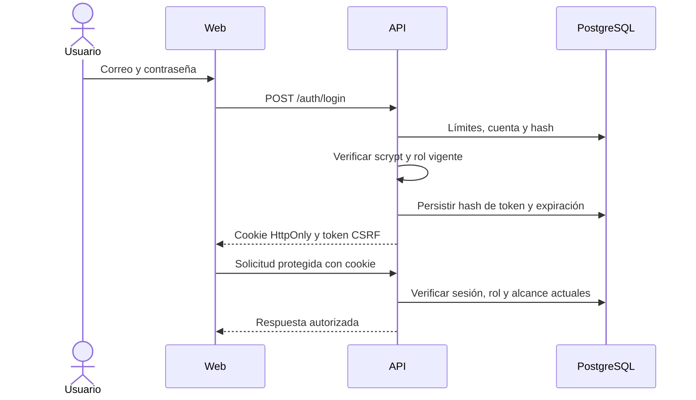
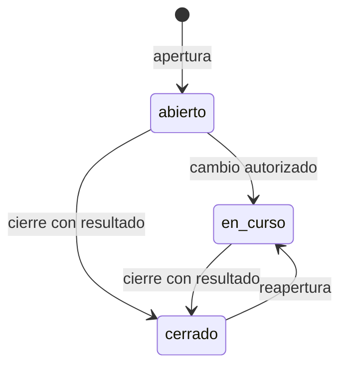
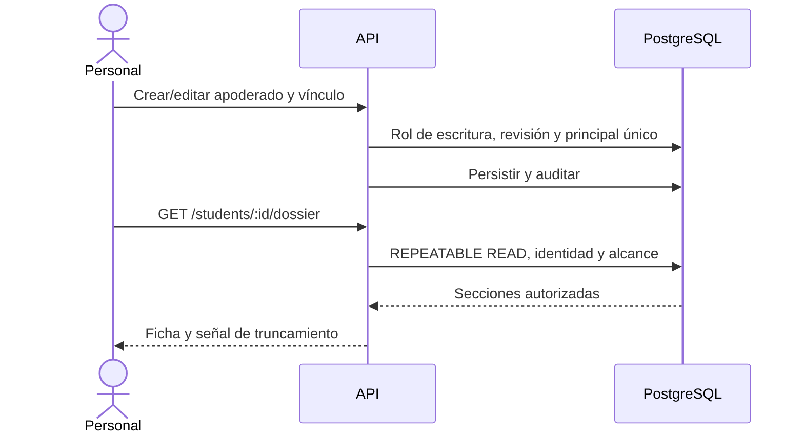
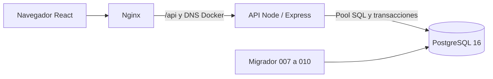

# UML de flujos persistentes - SIGAA 0.9.1

Corte de implementación: 28-10-2026. Para revisión, sin aceptación del PO.
PDF canónico: [UML actualizado](<../../output/pdf/UML de flujos persistentes - SIGAA.pdf>).
El diagrama inicial de Sprint 1 expresaba alcance futuro. Estos modelos lo
sustituyen con el comportamiento del código persistente y distinguen los límites.

## Actores y casos de uso

| Actor | Alcance implementado |
|---|---|
| Administración | Estructura, matrículas, reglas, seguimiento y apoderados |
| Docente | Datos académicos de asignaciones autorizadas; seguimiento según curso y responsabilidad |
| Inspectoría | Justificaciones, casos y apoderados |
| Dirección / UTP | Seguimiento autorizado y consulta de apoderados |
| Estudiante | Datos académicos propios publicados, asignaturas y calendario |

Todos inician sesión y gestionan sus sesiones. El apoderado es una entidad
administrada, no un actor con login implementado. El motor de alertas es parte
de la API, no un servicio externo autónomo.

## Autenticación



401 ante credenciales/sesiones inválidas; 429 ante límite; 403/404 según
recurso fuera del alcance. Modificaciones requieren origen y CSRF correctos.
El menú oculto no sustituye la autorización del servidor.

## Datos académicos y calendario

```mermaid
sequenceDiagram
    actor D as Docente
    participant A as API
    participant B as PostgreSQL
    actor E as Estudiante
    D->>A: Crear clase o registrar datos académicos
    A->>B: Validar asignación y datos; transacción y auditoría
    D->>A: PATCH clase/publication con revisión
    A->>B: Bloquear y publicar clase programada
    A-->>D: Resultado o conflicto 409
    E->>A: GET /student/calendar/:id
    A->>B: Identidad y matrícula vigente; eventos publicados
    B-->>A: Solo clases no canceladas y evaluaciones visibles
    A-->>E: Calendario propio
```

Publicar una clase no marca asistencia. La asistencia corresponde a clases
realizadas; notas y anotaciones conservan sus rutas y controles de visibilidad.
Asignaturas requieren matrícula, curso, periodo y asignación activos. Calendario:
hasta 92 días y 500 eventos, con señal de truncamiento.

## Alerta, caso y aviso

```mermaid
sequenceDiagram
    actor U as Personal autorizado
    participant A as API
    participant B as PostgreSQL
    U->>A: POST /followup/cases desde alerta
    A->>B: Comprobar alcance y responsable válido
    A->>B: Caso activo único por alerta
    A->>B: Actividad, auditoría y avisos en misma transacción
    A-->>U: Confirmación tras COMMIT
    U->>A: Intervenir/cerrar/reabrir con expectedRevision
    A->>B: Bloquear caso; validar versión y responsabilidad
    A->>B: Cambio + historial + avisos
    A-->>U: Resultado o 409
```



El caso no resuelve automáticamente la alerta. Los avisos son referencias sin
copias de notas sensibles, dirigidas al creador y responsable activos, excluyendo
al actor. Clave única por destinatario/caso/revisión. Consultar o marcar leído
exige ser destinatario y conservar acceso; no se envían correos ni avisos a alumnos.

## Apoderados y ficha integral



Administración/Inspectoría escriben; Dirección/UTP consulta. El docente no recibe
contactos; el estudiante no recibe casos, alertas internas o apoderados.
Anotaciones privadas ajenas permanecen ocultas. Máximo 500 registros por sección.

## Estructura y justificaciones

Administración modifica `/structure/:kind` con integridad y auditoría. Inspectoría
registra justificaciones solo sobre ausencias vigentes de clases realizadas y
no futuras; una aceptación actualiza la asistencia y recalcula el riesgo.
Reglas versionadas y recalculado explícito están en `support-routes.js` y
`risk-engine.js`; el motor deduplica alertas activas.

## Componentes



Docker local usa base independiente sin puerto publicado, web/API en loopback.
Nginx renueva la dirección del servicio api tras reinicios. La API exige las
versiones de esquema de seguridad, operación, seguimiento y notificaciones.
HTTPS público de 0.9.1 y restauración de respaldo aún no acreditados.

Fuentes de verificación: `apps/api/src`, pruebas de integración y
`output/evidence/sprint-5-completion/`. El PDF contiene siete páginas con los
actores, secuencias, componentes, condiciones y trazabilidad correspondientes.
